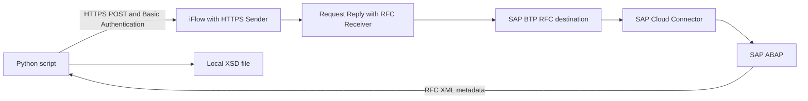

# RFC Metadata Downloader — SAP setup and usage guide

The `rfc_metadata_get.py` script retrieves metadata for an RFC or an IDoc basic type and generates a local XSD file. It requires Python 3.9 or later and uses only the Python standard library.

This guide describes deployment on SAP Integration Suite, Cloud Integration, in Cloud Foundry, with access to an on-premise SAP ABAP system through SAP Cloud Connector. Menu and field names may vary with the tenant version.

## 1. Solution flow



The iFlow receives the XML sent by the script, calls the SAP function identified in the payload, and returns its XML response synchronously. The RFC adapter communicates with the backend through SAP JCo. Configure the destination and make the schemas of the called functions available when preparing the flow. [RFC Receiver adapter](https://help.sap.com/docs/integration-suite/sap-integration-suite/rfc-receiver-adapter)

### How the script retrieves metadata

| Execution | Metadata query |
| --- | --- |
| RFC, automatic mode | Tries `RFC_METADATA_GET` with `DEEP=X` and `EVALUATE_LINKS=X`. If the query or XSD construction fails, tries `RFC_GET_FUNCTION_INTERFACE`. |
| `--rfc-method RFC_METADATA_GET` | Uses the parameters, types, and references returned by the function itself. A missing required definition causes an error. |
| `--rfc-method RFC_GET_FUNCTION_INTERFACE` | Retrieves the signature and supplements structures with `DDIF_FIELDINFO_GET` and table types with `DDIF_TTYP_GET`. |
| `--type idoc` | Uses `IDOCTYPE_READ_COMPLETE` and retrieves `EDI_DC40` through `DDIF_FIELDINFO_GET`. |

The RFC XSD contains global request and response elements. The IDoc XSD includes `IDOC`, the `EDI_DC40` control record, segments, and their cardinalities. IDoc fields are represented as text with a length limit when available.

## 2. Prerequisites

- SAP Integration Suite with Cloud Integration enabled and access to create, configure, deploy, and monitor iFlows.
- The SAP BTP subaccount and Cloud Foundry space used by the runtime.
- SAP Cloud Connector connected to that subaccount, with network access to the ABAP server.
- Administrative access to Cloud Connector and BTP destination configuration.
- An SAP ABAP technical user, client, and authorizations for the metadata functions.
- Credentials to call the iFlow endpoint, as described in section 5.
- Python 3.9 or later on the machine running the script, with DNS resolution and HTTPS access to the runtime URL.

The solution has two authentication points. The script authenticates with the Cloud Integration endpoint. The RFC destination authenticates with the backend using the SAP ABAP technical user configured in BTP. Configure the appropriate credentials at each point.

## 3. Configure SAP Cloud Connector

### 3.1. Connect the subaccount and map the backend

1. Open the SAP Cloud Connector administration interface.
2. Add or select the subaccount hosting Cloud Integration and confirm that it is connected.
3. Open **Cloud To On-Premise** and add a mapping for an **ABAP System** using **RFC**.
4. For a simple setup, select a direct connection to the application server.
5. Enter the internal host and instance number of the SAP ABAP system.
6. Define a virtual host and virtual instance number, such as `sap-dev-virtual` and `00`.
7. Check system availability through Cloud Connector.
8. If the connector uses a **Location ID**, record it for destination configuration.

Use the virtual values from this mapping in the destination. Cloud Connector maps those values to the internal backend. [RFC access control](https://help.sap.com/docs/connectivity/sap-btp-connectivity-cf/ca5868997e48468395cf0ca4882f5783.html)

### 3.2. Allow access to the RFC functions

In the mapping, open **Resources Accessible On**, select **Add**, and register the functions required by the modes you will use. Select exact matching for each name.

| Function | Script usage |
| --- | --- |
| `RFC_METADATA_GET` | First attempt in automatic mode and explicit method of the same name |
| `RFC_GET_FUNCTION_INTERFACE` | Automatic fallback and explicit legacy method |
| `DDIF_FIELDINFO_GET` | DDIC fields in the legacy method and the IDoc control record |
| `DDIF_TTYP_GET` | Table types in the legacy method, depending on the queried signature |
| `IDOCTYPE_READ_COMPLETE` | Metadata for IDoc basic types and extensions |

**Allowing these functions in Cloud Connector is necessary for the iFlow to call them.** Mapping the host and instance alone does not grant access to all functions. Cloud Connector enforces an allowlist of resources. [Accessible RFC resources](https://help.sap.com/docs/connectivity/sap-btp-connectivity-cf/ca5868997e48468395cf0ca4882f5783.html)

The adapter/JCo may also perform technical repository queries at runtime. If another function is blocked, identify the requested name in the monitor and Cloud Connector logs, then update access with the Basis team.

The business RFC name supplied to the script is queried as metadata. For example, when you supply `BAPI_COMPANYCODE_GETLIST`, the script sends that name as a parameter to the metadata functions.

### 3.3. SAP ABAP authorizations

The Basis team should confirm in SE37 that the functions exist, have the expected interfaces, and are remote-enabled in the backend release. The technical user needs the applicable RFC authorizations, including `S_RFC`, execution activity `16`, for the required modules or groups. Use SAP authorization diagnostics to investigate failures. [RFC access checks](https://help.sap.com/docs/cloud-integration-for-data-services/sap-data-services-agent/s-rfc-authorization-check-for-rfc-access-4dbbb39156644ac88a1cef8433f27308)

Both Cloud Connector access and ABAP user authorization must be configured. SAP documents authorization errors for `RFC_METADATA_GET`. [SAP KBA 3584104](https://userapps.support.sap.com/sap/support/knowledge/en/3584104)

Verify that `DDIF_TTYP_GET` can be called remotely in the target system. If the release does not support that call, use the explicit `RFC_METADATA_GET` method, which resolves types from its own response, or address legacy method compatibility with the SAP team.

## 4. Create the RFC destination in SAP BTP

In the Cloud Integration subaccount, open **Connectivity > Destinations** and create a destination named `SAP_METADATA_RFC`.

| Field or property | Example value or guidance |
| --- | --- |
| Name | `SAP_METADATA_RFC` |
| Type | `RFC` |
| Proxy Type | `OnPremise` |
| User / Password | SAP ABAP technical user credentials |
| Location ID | The Cloud Connector value, when configured |
| `jco.client.ashost` | Cloud Connector virtual host, such as `sap-dev-virtual` |
| `jco.client.sysnr` | Virtual instance number, such as `00` |
| `jco.client.client` | SAP client, such as `100` |
| `jco.client.lang` | Language, such as `EN` |
| `jco.destination.proxy_type` | `OnPremise`, depending on the fields available in the editor |

Configure the username and password in the editor fields or in the `jco.client.user` and `jco.client.passwd` properties supported by the destination configuration. Keep the values consistent if the editor displays both forms. [Create an RFC destination in Integration Suite](https://help.sap.com/docs/SAP_INTEGRATION_SUITE/sap-integration-suite/creating-rfc-destination)

For a sample set of on-premise connection properties, see the connectivity documentation. [SAP RFC destination example](https://help.sap.com/docs/connectivity/sap-btp-connectivity-cf/on-premise-configure-rfc-destination)

## 5. Credentials for accessing the iFlow

The current script uses **HTTP Basic Authentication**. Supply a username and password accepted by the runtime, or use the `clientid` and `clientsecret` from a service key configured for this access method.

### 5.1. Username and password

1. Provision a user in the identity provider accepted by the tenant for Basic Authentication.
2. In BTP, configure a role collection containing the `MessagingSend` role from the `it-rt` runtime application.
3. Assign the role collection to the user.
4. Configure the HTTPS Sender with **Authorization = User Role** and **User Role = ESBMessaging.send**.
5. Supply the user through `--user` or `SAP_USER`, and the password through the prompt or `SAP_PASSWORD`.

Confirm with the tenant administrator which login identifier the IdP accepts for Basic Authentication. SAP documentation describes role assignment and possible propagation delays. [Basic Authentication with an IdP user](https://help.sap.com/docs/integration-suite/sap-integration-suite/basic-authentication-of-idp-user-for-integration-flow-processing)

### 5.2. Service key with clientid and clientsecret

1. In BTP Cockpit, open **Services > Instances and Subscriptions**.
2. Create a **Process Integration Runtime** service instance with the **integration-flow** plan.
3. In the instance parameters, assign the `ESBMessaging.send` role matching the HTTPS Sender role.
4. Create a **Service Key** with **Key Type = ClientId/Secret**.
5. Retrieve the returned `clientid` and `clientsecret` fields.
6. Pass `clientid` as the script username and `clientsecret` as the password.

In this scenario, the service key provides Basic credentials used directly at the endpoint. The current script does not request an OAuth token or read a service key JSON file. [Basic Authentication with clientid and clientsecret for iFlows](https://help.sap.com/docs/integration-suite/sap-integration-suite/basic-authentication-with-clientid-and-clientsecret-for-integration-flow-processing?locale=en)

If your organization requires OAuth Bearer authentication, the Python client will need to be extended to obtain and send a token. [OAuth Client Credentials for iFlow processing](https://help.sap.com/docs/cloud-integration/sap-cloud-integration/oauth-with-client-credentials-grant-for-integration-flow-processing%26locale%3Den-US)

## 6. Create the iFlow with HTTPS Sender and RFC Receiver

### 6.1. Flow structure

1. Open **Design > Integrations and APIs** in Cloud Integration.
2. Create or open an integration package.
3. Add an **Integration Flow**, for example `SAP Metadata Download`.
4. Edit the artifact and use a synchronous process with **Start > Request Reply > End**.
5. Connect the **Sender** participant to Start through the **HTTPS** adapter.
6. Create the **Receiver** participant, for example `SAP_ABAP`.
7. Connect the Request Reply step to the Receiver through the **RFC** adapter.

Request Reply must receive the request XML and pass the adapter response XML through to End.

### 6.2. Configure the HTTPS Sender

| Field | Configuration |
| --- | --- |
| Address | `/rfc_metadata_get` |
| Authorization | `User Role` |
| User Role | `ESBMessaging.send` or the custom role assigned to the caller |
| CSRF Protected | To run the current script directly, the endpoint must accept POST requests without a CSRF token |

The script sends POST requests with `Content-Type: application/xml; charset=utf-8`. The CSRF Protected option requires token handling for modifying requests. The current client does not retrieve and resend this token. Review this setting with the tenant administrator when configuring the endpoint for this client. [HTTPS Sender and CSRF](https://help.sap.com/docs/cloud-integration/sap-cloud-integration/https-sender-adapter?locale=en-US)

SAP recommends enabling CSRF protection for these endpoints. If required in your environment, deployment with the current script depends on implementing this support before end-to-end testing. [SAP guidance on CSRF protection](https://help.sap.com/doc/978cdb2059244c10b55a8bd916484a63-f8f22daf4eb445ccbd1133deea0d2253/CLOUD/en-US/1b20578cbf8949b0b7a6b7af80c109ba.html)

### 6.3. Configure the RFC Receiver

1. Enter `SAP_METADATA_RFC` in the **Destination** field.
2. Use synchronous communication to receive the metadata response.
3. Leave **Send Confirm Transaction** unchecked for this query flow.
4. Preserve the incoming XML in the body until it reaches the adapter.
5. Prepare the metadata function XSD/WSDL resources required by the adapter configuration. Obtain them from the SAP system or the Basis/integration team before the first deployment.
6. If the adapter interface or tenant validation requires configuration per operation, create a Router based on the root element name and a Request Reply/RFC channel for each function listed in section 3.2, using the same inbound URL.

The XSD generated by Python is the result of querying the business object. For initial adapter configuration, use the schemas of the technical functions the iFlow will call. SAP documentation describes retrieving WSDL from the backend and indicates that ABAP interface changes may require redeploying the iFlow. [RFC Receiver configuration and requirements](https://help.sap.com/docs/integration-suite/sap-integration-suite/rfc-receiver-adapter)

### 6.4. XML contract expected by the script

Example request body for querying an RFC through `RFC_METADATA_GET`.

```xml
<?xml version="1.0" encoding="utf-8"?>
<rfc:RFC_METADATA_GET xmlns:rfc="urn:sap-com:document:sap:rfc:functions">
  <DEEP>X</DEEP>
  <EVALUATE_LINKS>X</EVALUATE_LINKS>
  <FUNCTIONNAMES>
    <item>
      <FUNCTIONNAME>BAPI_COMPANYCODE_GETLIST</FUNCTIONNAME>
    </item>
  </FUNCTIONNAMES>
</rfc:RFC_METADATA_GET>
```

The response must contain the `RFC_METADATA_GET.Response` root element and the `PARAMETERS`, `DATATYPESCONT`, and, when applicable, `INDIRECTTYPES` tables. Also preserve `FUNC_ERRORS` so the script can identify failures returned by SAP.

For the legacy method attempt, the script sends the following XML.

```xml
<rfc:RFC_GET_FUNCTION_INTERFACE xmlns:rfc="urn:sap-com:document:sap:rfc:functions">
  <FUNCNAME>BAPI_COMPANYCODE_GETLIST</FUNCNAME>
</rfc:RFC_GET_FUNCTION_INTERFACE>
```

In this case, the response must use `RFC_GET_FUNCTION_INTERFACE.Response` and contain the `PARAMS` table. Supplemental queries and IDoc queries follow the same function name and `.Response` suffix convention. Table rows use `item` elements.

Return the response XML in the HTTP body. Avoid transformations that rename tables, fields, or the root element, or convert the response to JSON.

## 7. Save, configure, and deploy

1. Save and validate the iFlow in the editor.
2. If you externalized the destination name or address, open **Configure** and enter the environment values.
3. Select **Deploy**.
4. Under **Monitor > Integrations and APIs > Manage Integration Content**, locate the artifact.
5. Wait for the **Started** status and review the deployment details.
6. Copy the HTTPS endpoint published by the runtime.
7. Supply that URL through `--url` or `SAP_URL`.

For the example address, the URL has the form `https://<runtime-host>/http/rfc_metadata_get`. Use the address shown in the tenant monitor. Confirm that the flow supports the functions needed for the primary query, fallback, and IDoc mode you intend to use.

## 8. Run the script

Open a terminal in the project folder and verify the Python installation.

```powershell
python --version
python .\rfc_metadata_get.py --help
```

### 8.1. Configure the URL and username

Copy .env.example to .env and enter SAP_URL, SAP_USER, and SAP_PASSWORD. The script loads .env beside the script automatically. Explicit command-line options take precedence over environment variables, which take precedence over .env values. Values are literal: no variable expansion, escape processing, or inline comments. Leave SAP_PASSWORD empty to use the secure password prompt. The local .env file is ignored by Git; .env.example contains placeholders only.

SAP_DESTINATION records the local RFC destination name for deployment. Copy that value into the iFlow DESTINATION parameter in Cloud Integration; the Python client does not deploy or configure SAP destinations.

| Environment variable | Value |
| --- | --- |
| `SAP_URL` | Complete iFlow HTTPS endpoint |
| `SAP_USER` | Username or service key clientid |
| `SAP_PASSWORD` | Password or service key clientsecret |

```powershell
$env:SAP_URL = 'https://<runtime-host>/http/rfc_metadata_get'
$env:SAP_USER = '<username-or-clientid>'
python .\rfc_metadata_get.py BAPI_COMPANYCODE_GETLIST
```

The script prompts for the password without displaying it. When using a service key, enter the `clientsecret` at this prompt. For automated execution, provide the secret in `SAP_PASSWORD` through your environment's secret management mechanism.

There is no tenant-specific default URL. Set SAP_URL in your local .env file or supply --url.

### 8.2. RFC with automatic fallback

```powershell
python .\rfc_metadata_get.py BAPI_COMPANYCODE_GETLIST --output companycodes.xsd
```

If `RFC_METADATA_GET` fails, the script reports the error in the terminal and tries `RFC_GET_FUNCTION_INTERFACE`. If both fail, the final message includes both errors. The output file is written after schema construction.

### 8.3. Force a method

```powershell
python .\rfc_metadata_get.py BAPI_COMPANYCODE_GETLIST --rfc-method RFC_METADATA_GET
python .\rfc_metadata_get.py BAPI_COMPANYCODE_GETLIST --rfc-method RFC_GET_FUNCTION_INTERFACE
```

Supplying `--rfc-method` explicitly selects that method, and a failure is returned directly.

### 8.4. IDoc and extension

```powershell
python .\rfc_metadata_get.py ORDERS05 --type idoc --release 757 --output ORDERS05.xsd
python .\rfc_metadata_get.py ORDERS05 --type idoc --release 757 --extension ZORDERS05 --output ZORDERS05.xsd
```

Replace `757` with the release applicable to the backend and IDoc. The positional name is the basic type. Supply the extension type through `--extension`. The SAP `IDOCTYPE_READ_COMPLETE` API retrieves segment and field structures and attributes. [IDoc type and segment API](https://help.sap.com/docs/ABAP_PLATFORM_NEW/8f3819b0c24149b5959ab31070b64058/4b3fbe158a1c2593e10000000a42189b.html)

### 8.5. Available parameters

| Parameter | Usage |
| --- | --- |
| `name` | RFC name or IDoc basic type |
| `--type rfc\|idoc` | Object type, defaults to `rfc` |
| `--url` | Complete HTTPS URL, also accepts `SAP_URL` |
| `--user` | Username or clientid, also accepts `SAP_USER` |
| `--password` | Password or clientsecret, also accepts `SAP_PASSWORD` or a prompt |
| `--rfc-method` | Forces `RFC_METADATA_GET` or `RFC_GET_FUNCTION_INTERFACE` |
| `--release` | Required for IDoc |
| `--extension` | IDoc extension type |
| `--idoc-namespace` | Namespace of the IDoc XML to validate |
| `--output` | XSD path, defaults to `<name>.xsd` |
| `--timeout` | Per-call timeout in seconds, defaults to `30` |

The output directory must exist. The script returns exit code `0` on success and `1` for handled connection, metadata, or file writing failures. Argument errors return exit code `2`.

## 9. Troubleshooting

| Symptom | Check |
| --- | --- |
| DNS failure or `getaddrinfo failed` | URL host, DNS, VPN, and connectivity on the machine running Python |
| HTTP 401 | Username/password or clientid/clientsecret and inbound authentication configuration |
| HTTP 403 | Caller role and any CSRF token requirement |
| HTTP 404 | Configured address, URL copied from the monitor, and deployment status |
| RFC communication error | Destination, virtual host/instance, SAP client, Location ID, Cloud Connector, and backend access |
| Function blocked by Cloud Connector | Exact function entry in Resources Accessible On and connector logs |
| `RFC_NO_AUTHORITY` | ABAP user authorizations for the indicated function |
| `DDIF_TTYP_GET` unavailable | Remote-call compatibility in the SAP release and the `RFC_METADATA_GET` result |
| Missing type definition | DATATYPESCONT/INDIRECTTYPES response, deep query, and XML preservation by the iFlow |
| Unexpected response root | Flow response body, conversions/mappings, and function routed to the receiver |
| Timeout | Execution time and errors in the Cloud Integration monitor, backend, and connectivity |

Use **Monitor Message Processing** to locate the call and iFlow error. Correlate the timestamp with the RFC adapter monitor, Cloud Connector logs, and ABAP diagnostics.

## 10. Deployment verification

1. Confirm that Cloud Connector is connected, the backend is available, and the functions are allowed.
2. Confirm the destination, ABAP user, and authorizations.
3. Confirm that the iFlow is Started and the caller has access through username/password or a service key.
4. Run a known RFC with `--rfc-method RFC_METADATA_GET`.
5. Run with `--rfc-method RFC_GET_FUNCTION_INTERFACE` if you intend to use fallback.
6. Run without `--rfc-method` to verify the automatic first attempt.
7. If using IDoc, test a basic type/release available in the environment.
8. Check the generated XSD against a representative interface XML before incorporating it into another process.

Local development checks used simulated responses, including nested tables and automatic fallback. This guide describes the configuration to perform in the tenant. Deployment and end-to-end testing in the SAP environment remain pending.
