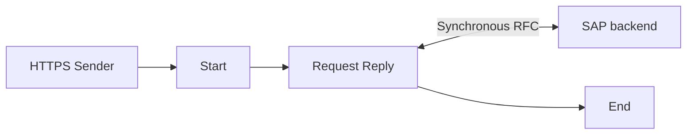

# RFC_METADATA_GET iFlow

This folder contains `RFC_METADATA_GET.zip`, an SAP Cloud Integration iFlow export that forwards incoming RFC XML requests to an SAP backend and returns the response synchronously.

## Package contents

| Item | Description |
| --- | --- |
| Bundle name / ID | `RFC_METADATA_GET` |
| Bundle version | `1.0.1` |
| Flow definition | `src/main/resources/scenarioflows/integrationflow/TEST_METADATA_DOWNLOADER.iflw` |
| Parameter values | `src/main/resources/parameters.prop` |
| Parameter definition | `src/main/resources/parameters.propdef` |
| Other files | Eclipse project metadata, bundle manifest, and export metadata |

The archive contains the flow definition and configuration metadata. Its process consists of Start, Request Reply, and End, connected to an HTTPS Sender and an RFC Receiver named `SAP`.



## Exported configuration

| Setting | Value |
| --- | --- |
| HTTPS address | `/rfc_metadata_get` |
| Endpoint pattern | `https://<runtime-host>/http/rfc_metadata_get` |
| Sender authorization | User Role, `ESBMessaging.send` |
| CSRF protection | Enabled, `xsrfProtection=1` |
| Maximum incoming body size | 40 MB |
| RFC destination parameter | `DESTINATION` |
| Exported destination value | Empty; configure before deployment |
| RFC message protocol | Synchronous RFC |
| Confirm transaction | Disabled, `transactioncommit=0` |
| Return exception to sender | Disabled |

The flow forwards the incoming body through Request Reply. The archive contains no scripts, mappings, routers, XSD files, or WSDL files. The function to invoke is supplied in the RFC XML payload. Confirm supported calls against the target backend during deployment.

## Import and deploy

1. Open an integration package in Cloud Integration under **Design > Integrations and APIs**.
2. Add an Integration Flow using the upload option and select `RFC_METADATA_GET.zip`.
3. Open **Configure** and set `DESTINATION` to the RFC destination available in the target subaccount. Use the SAP_DESTINATION value recorded in your local .env file.
4. Verify that the destination uses the correct SAP client, technical user, and Cloud Connector virtual host, instance, and Location ID.
5. Review the HTTPS Sender authorization and CSRF settings in the editor.
6. Save and deploy the artifact.
7. In **Monitor > Integrations and APIs > Manage Integration Content**, wait for **Started** and copy the published endpoint.

The destination and credentials must be provisioned in the target environment. The ZIP references the destination by name.

## Backend access and authentication

Configure Cloud Connector to allow the functions used by the Python downloader.

| Function | Purpose |
| --- | --- |
| `RFC_METADATA_GET` | Primary metadata query |
| `RFC_GET_FUNCTION_INTERFACE` | Fallback signature query |
| `DDIF_FIELDINFO_GET` | Supplemental DDIC fields and IDoc control record |
| `DDIF_TTYP_GET` | Table types in the legacy query path |
| `IDOCTYPE_READ_COMPLETE` | IDoc metadata |

The ABAP technical user also needs the applicable RFC authorizations. Check remote-call availability for each function in the backend release.

To access the HTTPS endpoint, use a user authorized for `ESBMessaging.send`, or the `clientid` and `clientsecret` of a Process Integration Runtime service key with the `integration-flow` plan and matching role. The downloader accepts those credentials through its username and password inputs.

See the [project setup guide](../README.md) for destination, Cloud Connector, and authentication instructions.

## Calling this flow from the downloader

Set the script URL to the deployed endpoint, whose path is `/http/rfc_metadata_get`.

```powershell
$env:SAP_URL = 'https://<runtime-host>/http/rfc_metadata_get'
$env:SAP_USER = '<username-or-clientid>'
python .\rfc_metadata_get.py BAPI_COMPANYCODE_GETLIST --rfc-method RFC_METADATA_GET
```

Run this command from the project root. Enter the password or clientsecret when prompted.

**The exported flow enables CSRF protection, and the current Python client does not implement CSRF token handling.** Calling it as exported requires extending the client to fetch a token and retain the associated session cookies before submitting POST requests. Review any change to the sender's protection setting with the tenant administrator. Missing or invalid tokens can cause HTTP 403. [SAP HTTPS Sender documentation](https://help.sap.com/docs/cloud-integration/sap-cloud-integration/https-sender-adapter?locale=en-US)

Copy .env.example to .env in the project root and set SAP_URL, SAP_USER, and SAP_PASSWORD. The script loads this file automatically; --url can override SAP_URL. No tenant URL is embedded in the script.

This documentation is based on inspection of the ZIP contents. Import, deployment, and live execution of this artifact have not been verified.
